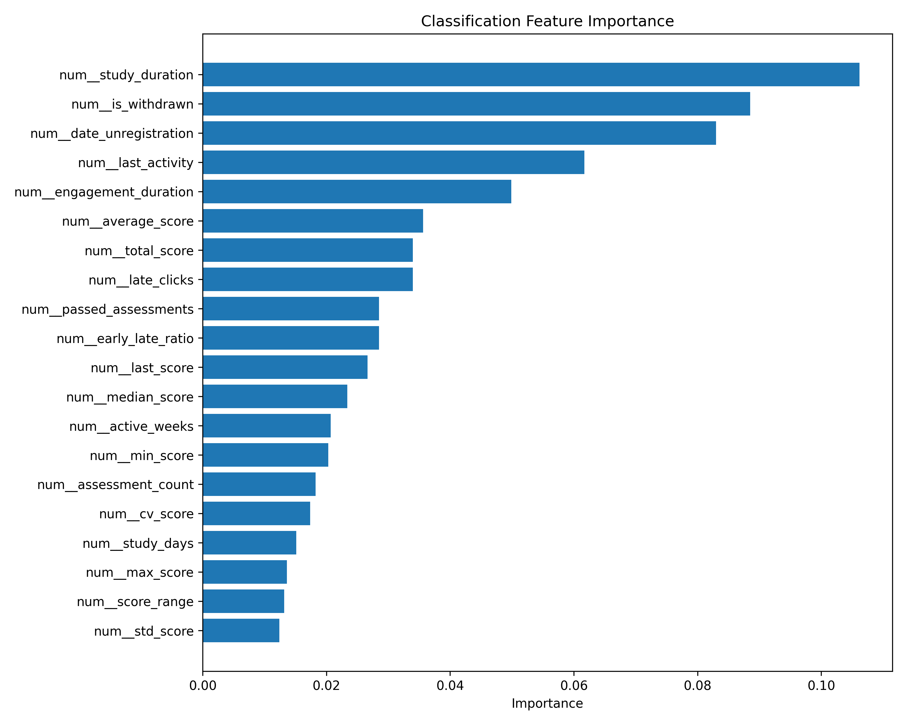
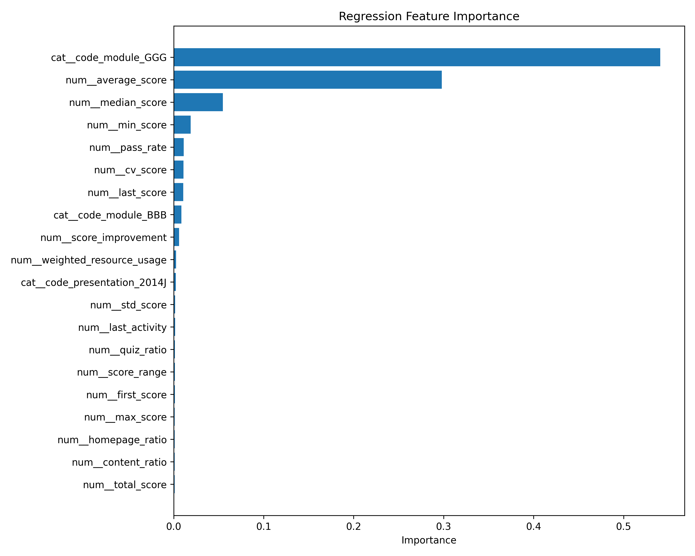
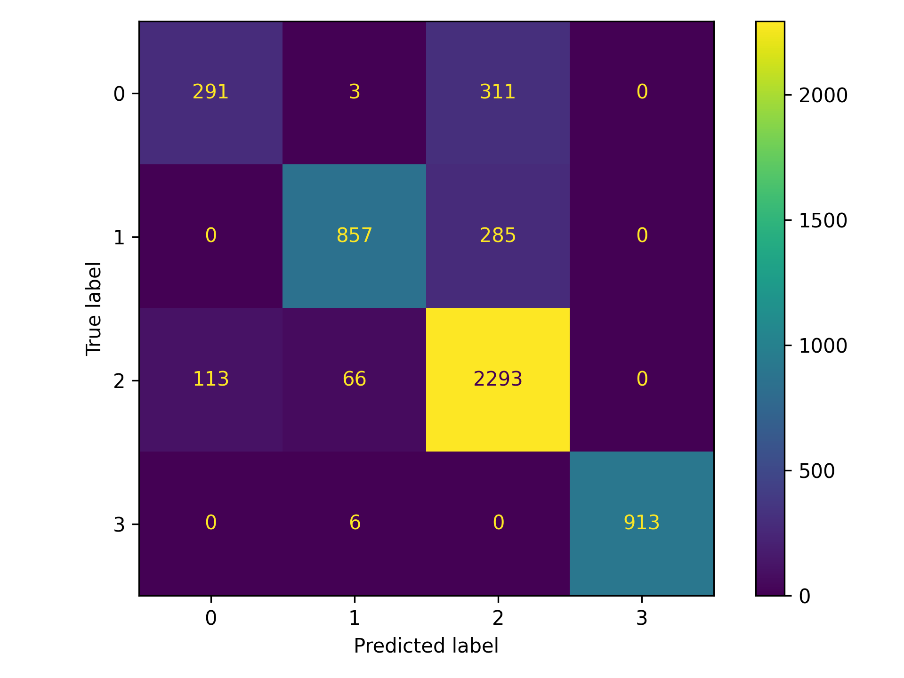
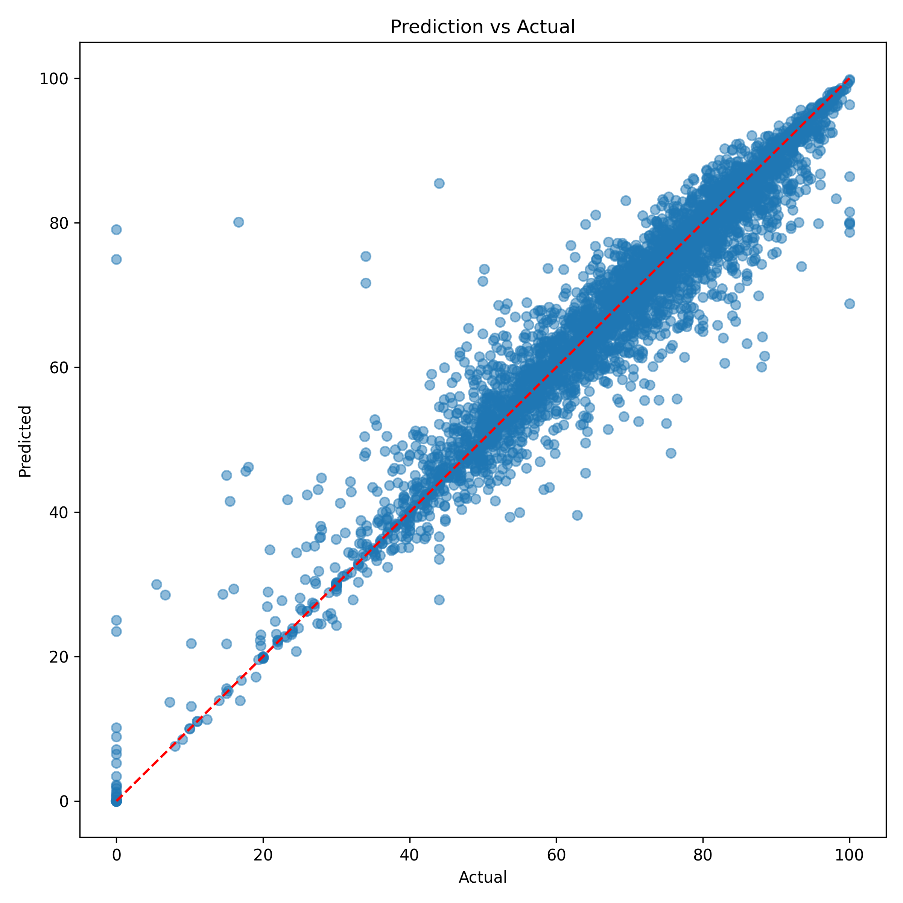
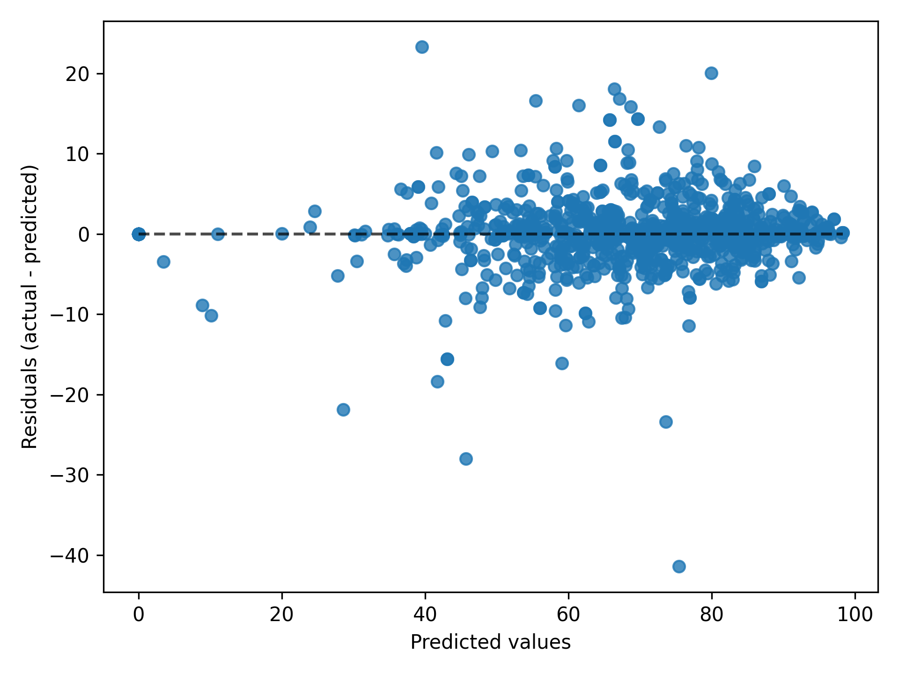

# EduSense – Student Performance Prediction using Machine Learning


## Overview

EduSense is an end-to-end Machine Learning project that analyzes student academic performance and predicts learning outcomes using the **Open University Learning Analytics Dataset (OULAD)**.

The project combines student demographics, assessment records, course registrations, and Virtual Learning Environment (VLE) activity to identify patterns in student performance.

It implements two prediction tasks:

- **Classification:** Predict the student's final academic result.
- **Regression:** Predict the student's final score.

The complete pipeline covers data integration, preprocessing, feature engineering, model training, evaluation, and model serialization.

## Project Highlights

- Integrated multiple educational datasets into a unified dataset.
- Engineered 77 academic and behavioral features.
- Analyzed student engagement through VLE interaction data.
- Implemented classification and regression models.
- Benchmarked multiple algorithms to identify the best-performing model.
- Generated evaluation reports and visualizations automatically.
- Saved trained models for future predictions.
- Followed a modular and reproducible project structure.

## Dataset

The project uses the **Open University Learning Analytics Dataset (OULAD)**.

It contains information about students, courses, assessments, registrations, and interactions with online learning resources.

### Datasets Used

| Dataset | Description |
|---|---|
| studentInfo | Student demographic information |
| studentAssessment | Student assessment scores |
| assessments | Assessment details and metadata |
| studentRegistration | Course registration information |
| studentVle | Student interactions with learning resources |
| vle | Virtual learning environment resources |
| courses | Course information |

## Feature Engineering

A total of 77 features are extracted from different data sources.

### Student Features
- Gender, age band and region
- Highest education
- Previous attempts
- Disability information

### Registration Features
- Registration date
- Unregistration date
- Enrollment duration

### Assessment Features
- Number of assessments
- Average, minimum and maximum scores
- Weighted assessment score
- Assessment completion rate

### VLE Engagement Features
- Total clicks
- Average daily clicks
- Active learning days
- Number of sessions
- Session duration
- Resource usage statistics
- Activity distribution

These features help capture both academic performance and student engagement patterns.

## Machine Learning Models

Two separate prediction tasks are implemented.

### 1. Classification – Final Result Prediction

Algorithms used:

- Logistic Regression
- Decision Tree Classifier
- Random Forest Classifier

**Best-performing model:** Random Forest

### 2. Regression – Final Score Prediction

Algorithms used:

- Linear Regression
- Decision Tree Regressor
- Random Forest Regressor

**Best-performing model:** Random Forest Regressor

Models are benchmarked automatically, and the best-performing model is selected based on the evaluation results.

## Model Performance

### Classification Results

| Model | Accuracy |
|---|---:|
| Logistic Regression | 72.95% |
| Decision Tree | 79.06% |
| Random Forest | **84.74%** |

### Regression Results

| Model | R² Score |
|---|---:|
| Linear Regression | 0.884 |
| Decision Tree | 0.923 |
| Random Forest | **0.967** |

Random Forest achieved the highest reported performance in both tasks.

*Note: These are the reported benchmark results. Performance should be validated using leakage-safe data splitting and an appropriate prediction-time cutoff before being interpreted as generalizable results.*

## Evaluation Metrics

**Classification**
- Accuracy
- Precision
- Recall
- F1-score
- Confusion Matrix

**Regression**
- Mean Absolute Error (MAE)
- Mean Squared Error (MSE)
- Root Mean Squared Error (RMSE)
- R² Score

## Visualizations

The pipeline automatically generates visual reports to understand model performance and feature contributions.

### Classification Feature Importance



### Regression Feature Importance



### Confusion Matrix



### Prediction vs Actual



### Residual Plot



## Project Structure

```text
student-performance-prediction/
│
├── artifacts/
│   ├── classification_model.pkl
│   └── regression_model.pkl
│
├── configs/
├── data/
├── notebooks/
│
├── outputs/
│   ├── master_dataset.csv
│   ├── classification_benchmark.csv
│   ├── regression_benchmark.csv
│   └── plots/
│
├── src/
│   ├── common/
│   ├── preprocessing/
│   ├── models/
│   ├── pipelines/
│   ├── evaluation/
│   └── utils/
│
├── main.py
├── requirements.txt
├── README.md
├── LICENSE
└── .gitignore
```

## Tech Stack

| Category | Technologies |
|---|---|
| Language | Python |
| Data Processing | Pandas, NumPy |
| Machine Learning | Scikit-learn |
| Visualization | Matplotlib |
| Model Serialization | Joblib |
| Utilities | Logging, Pathlib |

## Installation & Setup

### 1. Clone the repository

```bash
git clone https://github.com/YOUR-USERNAME/student-performance-prediction.git
cd student-performance-prediction
```

### 2. Create a virtual environment

```bash
python -m venv .venv
```

### 3. Activate the environment

**Windows**
```bash
.venv\Scripts\activate
```

**Linux / macOS**
```bash
source .venv/bin/activate
```

### 4. Install dependencies

```bash
pip install -r requirements.txt
```

### 5. Add the dataset

Download OULAD from its official source and place the extracted CSV files in the expected `data/` directory.

Dataset: https://analyse.kmi.open.ac.uk/open_dataset

### 6. Run the pipeline

```bash
python main.py
```

The pipeline automatically:

1. Loads and integrates the datasets.
2. Cleans and preprocesses the data.
3. Generates engineered features.
4. Trains classification and regression models.
5. Benchmarks model performance.
6. Selects the best-performing models.
7. Generates evaluation reports and plots.
8. Saves trained model artifacts.

## Saved Artifacts

After execution, the following files are generated:

```text
artifacts/
├── classification_model.pkl
└── regression_model.pkl
```

These serialized models can be loaded later for inference without retraining.

## Future Improvements

- Add XGBoost, LightGBM and CatBoost.
- Implement hyperparameter optimization using Optuna.
- Add SHAP-based model explainability.
- Build an interactive Streamlit dashboard.
- Develop a prediction API using FastAPI.
- Add MLflow for experiment tracking.
- Implement data validation and model drift detection.
- Introduce early-warning predictions using only information available at a defined point in the course.

## Key Learning Outcomes

- Data integration and preprocessing
- Exploratory data analysis
- Feature engineering
- Classification and regression
- Model benchmarking and evaluation
- Behavioral data analysis
- Feature importance
- Model serialization
- Building reproducible ML pipelines

## Author

**Shivansh Shukla**

Computer Science & Engineering

---

⭐ If you find this project useful, consider giving it a star!